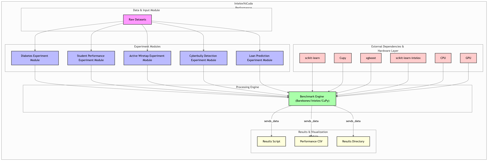
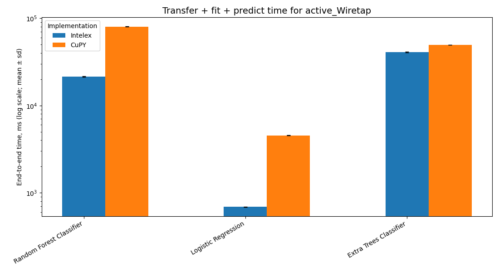
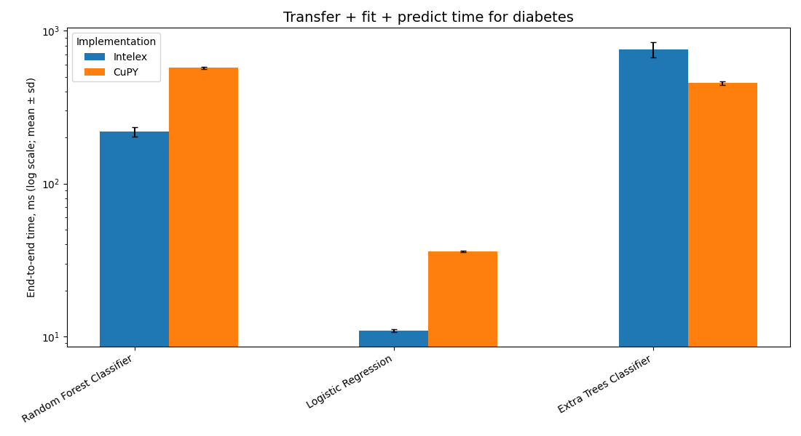
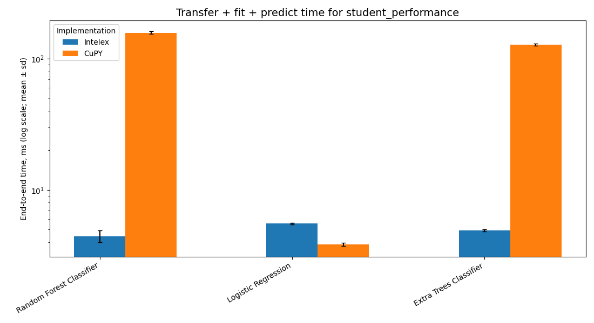

# IntelexVsCuda

**Benchmarking Intel® Extension for Scikit-learn (scikit-learn-intelex) vs. CuPy-accelerated methods for machine learning workflows.**

## Overview
This project benchmarks and compares the performance of various machine learning algorithms using [Intel's scikit-learn-intelex](https://github.com/intel/scikit-learn-intelex) and [NVIDIA's CuPy](https://cupy.dev/) acceleration across multiple datasets. The goal is to determine which optimization—CPU-based (Intelex) or GPU-based (CuPy)—performs better for specific algorithms and dataset types, as part of a college research project.

- **scikit-learn-intelex**: Optimizes select scikit-learn estimators using low-level CPU instructions and multi-threading for faster performance.
- **CuPy**: GPU array library with a NumPy-compatible API; enables GPU acceleration for array computations.

## Setup

**Install the required dependencies** (use the CuPy wheel matching your CUDA version, e.g. `cupy-cuda12x`):
```bash
pip install numpy scipy pandas matplotlib scikit-learn scikit-learn-intelex xgboost lightgbm cupy-cuda12x
```

**Put the dataset CSVs in `data/`** (git-ignored; see [Acknowledgments](#acknowledgments) for sources):
`Active_Wiretap_dataset.csv`, `Active_Wiretap_labels.csv`, `final_hateXplain.csv`, `diabetes_dataset.csv`, `Loan Prediction.csv`, `student_performance_dataset.csv`.

**Run the benchmark, then build the tables and charts:**
```bash
python benchmark.py --dataset all --impl all --repeats 9 --warmup 1   # appends to results/runs.csv
python results.py                                                     # writes results/summary.md, summary.csv and charts
```
Use `--dataset diabetes`, `--impl Intelex` or `--models "Random Forest Classifier"` to run a subset.

The notebooks in `models/` are the original exploratory code. Published numbers come from `benchmark.py`.

## Experiment Methodology

1. **Preprocessing** (`bench/data.py`): each dataset has a single preprocessing pipeline, shared by all implementations. Feature selection, TF-IDF and scaling are fitted on the training split only. Splits are stratified with a fixed seed.
2. **Models** (`bench/models.py`): the benchmark runs only the classifiers that scikit-learn-intelex actually patches, verified against `sklearnex.get_patch_map()`, so every Intelex measurement reflects a real oneDAL path. One hyperparameter set per model, the same on every dataset and implementation:
    - Random Forest
    - Logistic Regression
    - Extra Trees
   LightGBM and XGBoost (not scikit-learn) and AdaBoost and the MLP (scikit-learn, but not patched by sklearnex) were removed for that reason.
3. **Implementation Variants**:
    - **Intelex**: `patch_sklearn()` is applied in a fresh process *before* any estimator is imported, so each model runs on the oneDAL backend. The `Backend` column records which library actually ran each model (`sklearnex.*` when patched), so a fallback is visible rather than silently counted as "Intelex".
    - **CuPy**: data is moved to the GPU with CuPy. None of these three estimators has a CuPy/GPU training path, so the data is copied back to the host and they train on the CPU with stock scikit-learn. That round trip is measured as transfer time, so this variant is effectively *stock scikit-learn + transfer overhead*.
    - **BareBones** (stock scikit-learn, no transfer) is still available via `--impl BareBones` if an untaxed CPU baseline is wanted; the published run below compares Intelex against CuPy.
4. **Measurement protocol** (`bench/harness.py`):
    - **Warm-up**: 1 discarded run per model, so first-call overhead is excluded. This covers library loading, JIT/kernel compilation and the CUDA context, which is also created before any timer starts.
    - **Repeats**: 9 measured runs per model (configurable). Tables report **mean ± standard deviation**.
    - **Separate timers**: **transfer** (host↔GPU copies), **fit** (training) and **predict** (inference on the test split). GPU work is synchronised before each timer stops.
    - **Quality**: **accuracy** and **macro F1** on the held-out test split, reported next to every time. A speed-up that comes with a drop in F1 is not counted as a win.
    - **Speedup**: baseline mean time ÷ implementation mean time (> 1 = faster), reported for fit time and for end-to-end time (transfer + fit + predict).
    - Each implementation runs in its own Python process, so the Intelex patch cannot leak into the other runs.

# How the experiments were conducted


# Hardware used:

- **CPU**: Intel Core i9-10900F (10 cores / 20 threads)  
- **GPU**: NVIDIA GeForce RTX 4060 (8 GB)  
- **Storage**: SSD  
- **RAM**: 32 GB  

## Datasets
| Name                   | Size     | Features      | Notes                    |
|------------------------|----------|---------------|--------------------------|
| Wiretap                | 7 GB     | 115 numeric   | Largest                  |
| Loan Prediction        | 20 MB    | 12 categorical| Small                    |
| Student Performance    | 41 KB    | 10 numeric    | Smallest                 |
| Diabetes               | 3.81 MB  | 8 mixed       | Medium                   |
| Cyberbullying Detection| 3.67 MB  | 7 text/cat.   | Medium, text-heavy       |

## Results

Full per-cell tables (mean ± sd for transfer, fit, predict and total time, plus accuracy and macro F1 and the backend that actually ran) are in [`results/summary.md`](results/summary.md), produced by `python results.py`. The run below is all five datasets × the three patched models × 9 repeats, with Active Wiretap at full scale (2.28M rows).

### Intelex speedup vs CuPy (end-to-end: transfer + fit + predict)

Each cell is **CuPy total ÷ Intelex total**, so > 1 means Intelex is faster. Because none of these models has a GPU training path, "CuPy" here is stock scikit-learn plus the host↔GPU round trip, so this reads as *oneDAL vs stock scikit-learn*.

| Model | Wiretap (2.28M) | Cyberbullying (sparse) | Diabetes | Loan | Student |
|---|---|---|---|---|---|
| Random Forest | **3.8×** | 1.0× | **2.6×** | 0.94× | **36×** |
| Logistic Regression | **6.6×** | 1.0× | **3.3×** | 0.62× | 0.71× |
| Extra Trees | 1.2× | 1.0× | 0.60× | 1.2× | **26×** |

**What the numbers show:**

1. **oneDAL wins clearly on dense numeric data**, most of all for Logistic Regression and Random Forest: 6.6× and 3.8× on the full 2.28M-row Wiretap capture, and 3.3× / 2.6× on Diabetes.
2. **On sparse TF-IDF input (Cyberbullying) Intelex gives no speedup** — sklearnex falls back to stock scikit-learn for sparse data, so all three models tie.
3. **On tiny data (Student, ~700-row test split) the tree models are 26–36× faster** under Intelex, because oneDAL's fixed per-call overhead is far lower than stock scikit-learn's.
4. **Extra Trees is inconsistent** — oneDAL is slower than stock on Diabetes (0.60×) and a wash elsewhere, so it is not a blanket win.
5. **Accuracy and macro F1 match across implementations to ~4 decimals** on every cell, so the Intelex speedups come with no quality regression.

### Charts

End-to-end time per model (log scale, mean ± sd error bars), regenerated by `python results.py`:







---

## Contributing
Feel free to fork this repository, create a new branch, and submit a pull request with your changes. Please make sure to document it well.

## License
This project is licensed under the MIT License - see the [LICENSE](LICENSE) file for details.

## Acknowledgments
Mustafa, Mohammed. (n.d.). Diabetes Prediction Dataset [Dataset]. In Kaggle. https://www.kaggle.com/datasets/iammustafatz/diabetes-prediction-dataset

Maree, A. (2025). Student Performance Prediction [Dataset]. In Kaggle (Version V2). Keggal. https://www.kaggle.com/datasets/amrmaree/student-performance-prediction

Mirsky, Yisroel, Doitshman, Tomer, Elovici, Yuval, & Shabtai, Asaf. (2018). Kitsune: An Ensemble of Autoencoders for Online Network Intrusion Detection. In The Network and Distributed System Security Symposium (NDSS) 2018.

CyberBullying Detection Dataset. (n.d.). [Dataset]. In Kaggle (Version V2). Keggal. https://www.kaggle.com/datasets/sayankr007/cyber-bullying-data-for-multi-label-classification?select=final_hateXplain.csv

Star, Ethical. (2025). Loan Prediction. Kaggle.com.. https://www.kaggle.com/datasets/ethicalstar/loan-prediction/code
